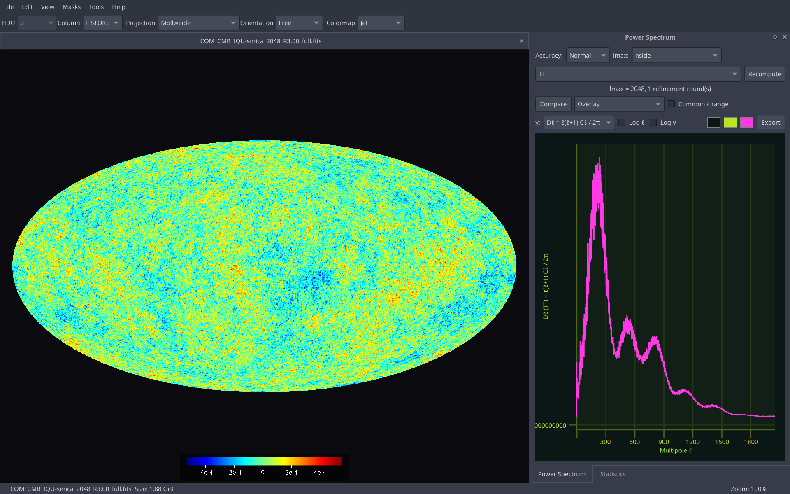
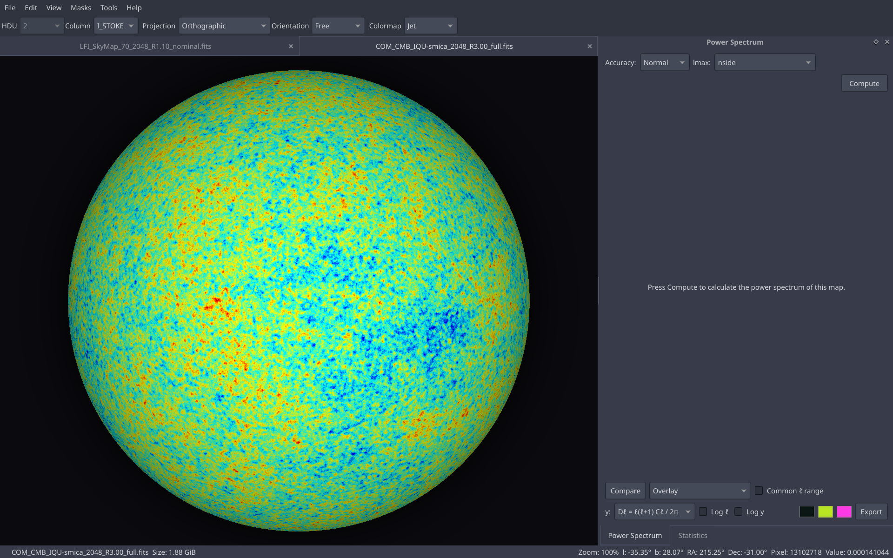
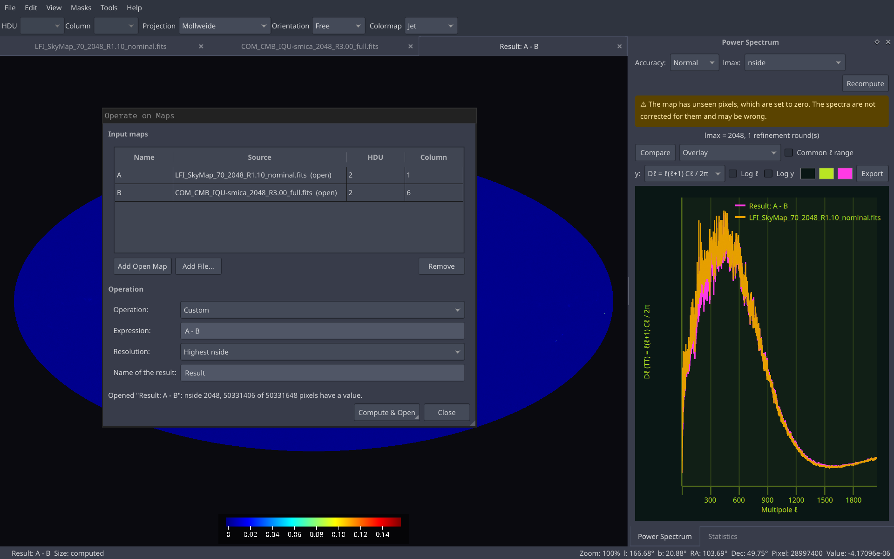

# hpvis

A fast, GPU-accelerated viewer for [HEALPix](https://healpix.sourceforge.io/)
maps. The projection and the HEALPix pixel lookup run per pixel in a fragment
shader, so large maps (nside 2048 and above) stay responsive.

## Screenshots







## Features

- Galactic, Ecliptic and Equatorial orientations (converted on the GPU from
  the map's own `COORDSYS`), or a free trackball.
- Eleven projections: Mollweide, Hammer, Equirectangular, Mercator, Sinusoidal,
  Lambert cylindrical, Gall-Peters, Orthographic, Azimuthal equidistant,
  Gnomonic and Stereographic, with interactive sky rotation, seen from the
  inside (the sky) or the outside (like a globe).
- RING and NESTED pixel ordering.
- 15 colormaps plus your own (CSV or JSON), linear and logarithmic scales, an adjustable color range and a
  color bar.
- Masks: load several, toggle, invert, and hide or dim the masked pixels.
- Graticule, minimap, zoom, pan and touchpad gestures.
- Several maps open at once in tabs, with a toolbar for HDU, column,
  projection and colormap.
- Operations on maps: add, subtract, multiply, divide or any expression of
  several maps, with the result opened as a new map and saved as FITS.
- Map statistics, a FITS header viewer, power spectrum (via NaMaster) and
  image export.
- Settings dialog for the defaults of new maps.


## Installation

See [INSTALLATION.md](INSTALLATION.md) for dependencies, build options and
install instructions.

## Usage

```sh
hpvis [options] [FILE...]
```

| Option | Description |
| --- | --- |
| `-H, --hdu N` | HDU to show (1-based, default: first map HDU) |
| `-c, --column N\|NAME` | Column to show, by number (1-based) or name such as `TT` (default: first) |
| `-m, --colormap NAME` | e.g. `viridis`, `inferno`, `jet`, a custom colormap name, or a colormap file |
| `-r, --reverse` | Reverse the colormap |
| `-s, --scale linear\|log` | Color scale |
| `--min V`, `--max V` | Color range |
| `-p, --projection P` | `mollweide`, `equirectangular`, `orthographic`, `azimuthal_equidistant`, `gnomonic`, `mercator`, `sinusoidal`, `lambert_cylindrical`, `gall_peters`, `stereographic`, `hammer` |
| `-o, --orientation O` | `free` (default), `galactic`, `ecliptic` or `equatorial`: the frame to show the sky in |
| `--view inside\|outside` | Perspective: the sky seen from the inside (longitude increases to the left, the default) or from the outside like a globe (mirrored) |
| `-g, --graticule` | Show the coordinate grid |
| `--mask FILE` | Apply a mask (repeatable) |
| `-e, --export FILE` | Save the view as an image and exit |
| `-i, --info` | List HDUs and columns and exit (no window) |
| `--stats` | Print min, max, mean, rms and std and exit (no window) |

Examples:

```sh
hpvis samples/wmap_W_iqu_nside32.fits
hpvis -p orthographic -m inferno -g map.fits
hpvis --mask mask.fits --export out.png map.fits
hpvis --info map.fits
```

Files can also be opened from File > Open or by dropping them on the window.

## Controls

| Action | Input |
| --- | --- |
| Zoom | Mouse wheel, pinch, or Ctrl + scroll (toward the cursor) |
| Pan | Left-drag, or two-finger scroll |
| Rotate the sky | Ctrl + left-drag or middle-drag (plain left-drag in the Orthographic, Azimuthal, Gnomonic and Stereographic views) |
| Zoom to a region | Shift + left-drag |
| Statistics of a region | Ctrl + Shift + left-drag (or View > Select Statistics Region); shown in the Statistics dock |
| Reset view | Double-click, or `0` |
| Toggle minimap | `M` |
| Toggle color bar | `C` |
| Open / close tab | `Ctrl+O` / `Ctrl+W` |

## Custom colormaps

Add your own colormaps as CSV or JSON files, either with
**View > Custom Colormaps > Load Colormap...** (the file is copied into the
colormaps folder) or by putting them in that folder yourself
(**View > Custom Colormaps > Open Colormaps Folder**, `colormaps/` in the
app's config directory). They are picked up at startup and appear after the
built-in ones in the toolbar and in Settings. `--colormap` takes their name or
a file path. You can have up to 64.

CSV: one color per line, as `r,g,b` (0-1 or 0-255) or `#rrggbb`. A header line
and `#` comments are ignored. Colors are spread evenly over the range.

```csv
r,g,b
0,0,0
255,0,0
255,255,0
255,255,255
```

JSON: a name and a list of colors, each a `"#rrggbb"` string, an `[r, g, b]`
array, or `{"position": 0-1, "color": ...}` for uneven spacing (all or none
of the colors need a position).

```json
{
  "name": "Ice",
  "colors": [
    {"position": 0.0, "color": "#000020"},
    {"position": 0.3, "color": [0.0, 0.5, 1.0]},
    {"position": 1.0, "color": "#ffffff"}
  ]
}
```

Colors between the entries are interpolated linearly. At least two colors are
needed.

## Samples

`samples/` has small test maps and masks (WMAP and Planck dust data, and
synthetic maps at nside 32 up to 8192).

## Settings

Preferences are stored with `QSettings` (on Linux, under `~/.config`), and
the recent files list under `~/.local/share/hpvis/`.

## Caveats

- Maximum nside is 8192. The map is kept on the GPU as 32-bit floats, 4 bytes
  per pixel: nside 2048 needs 0.2 GB, nside 4096 needs 0.8 GB and nside 8192
  needs 3.2 GB of video memory (integrated GPUs share system memory). Maps
  with a larger nside than the "Stream maps above nside" setting (Settings >
  General, default 4096) are streamed instead: a coarse copy (at most nside
  2048) stays on the GPU and the full-resolution tiles on screen are loaded as
  you zoom and pan, which needs only a few hundred MB whatever the nside. The
  map is also held in RAM in full (3.2 GB at nside 8192).
- While streaming, zooming in shows the coarse map for a moment until the
  tiles arrive, and masks are applied at the coarse resolution.
- The GPU's maximum texture size (usually 16384) also caps nside when not
  streaming.
- If the GPU cannot allocate the textures, a message is shown and the map is
  not displayed; lower the streaming limit in the settings.

See [CHANGELOG.md](CHANGELOG.md) for the list of changes.
